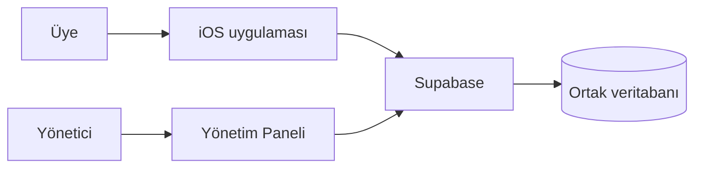

# CampusDogs Sunum ve Demo Rehberi

Bu rehber, teknik geçmişi olmayan 3–4 kişilik grupların CampusDogs'u güvenle anlatması için hazırlanmıştır. Amaç, teknolojiyi gereğinden fazla ayrıntıya boğmadan doğru açıklamak ve gerçek sistem sınırlarını gizlememektir.

## 1. Sunuma başlamadan önce kontrol listesi

Canlı demo için aşağıdakileri sunumdan önce kontrol edin:

1. iPhone uygulaması fiziksel cihazda veya Simulator'da açılıyor mu?
2. Uygulamanın yerel Supabase yapılandırması hazır mı? Değerleri ekrana yansıtmayın.
3. Yönetim paneli açılıyor mu ve demo için yetkili yönetici hesabı var mı?
4. En az bir aktif köpek, bir bakım ikonu, yayımlanmış bir duyuru ve mümkünse son konum kaydı var mı?
5. iPhone internete bağlı mı? Konum güncelleme demosu yapılacaksa konum izni verilmiş mi?
6. Gözlem bildirimi demo verisiyle yapılacaksa, sunum sonrasında kaydın yönetici panelinde incelenebileceği biliniyor mu?
7. Sunum sırasında gerçek kişisel konum, parola, anahtar veya hassas sağlık bilgisinin görünmeyeceğinden emin misiniz?

> Bluetooth akışını ancak “simüle edilmiş demo” olarak anlatın. Gerçek bir tasmanın bulunduğunu veya canlı olarak tarandığını söylemeyin.

## 2. Önerilen sunum akışı

| Sıra | Konu | Süre önerisi | Ana mesaj |
| --- | --- | ---: | --- |
| 1 | Giriş | 1 dk | CampusDogs, kampüs köpekleriyle ilgili bilgiyi merkezi ve anlaşılır hale getirir. |
| 2 | Problem | 1 dk | Sağlık, bakım uyarısı, duyuru ve gözlem bilgisinin dağınık kalmasını azaltmayı hedefler. |
| 3 | Hedefler | 1 dk | Bilgilendirme, sorumlu yaklaşım, anonim bildirim ve yönetilebilir kayıtlar. |
| 4 | Sistem mimarisi | 2 dk | iOS uygulaması ve yönetim paneli aynı güvenli merkezi veriye bağlanır. |
| 5 | Teknolojiler | 1–2 dk | SwiftUI/iOS, React/TypeScript, Supabase/PostgreSQL, MapKit/OpenStreetMap. |
| 6 | iOS demosu | 3–4 dk | Köpek profili, bakım ikonu, yaş, sağlık geçmişi, harita, duyuru, gözlem bildirimi. |
| 7 | Yönetim paneli demosu | 3–4 dk | Dashboard, köpek/sağlık yönetimi, ikon ataması, bildirim inceleme, duyuru. |
| 8 | Ortak arka uç ve güvenlik | 1–2 dk | Aynı veri kaynağı; yönetici girişi ve RLS. |
| 9 | Uçtan uca örnek | 1–2 dk | Üyenin bildirimi yöneticinin ekranına ulaşır; yönetici inceler. |
| 10 | Sınırlar ve gelecek | 1–2 dk | Son konum ≠ canlı takip; Bluetooth demo; gerçek donanım gelecek adım. |
| 11 | Sonuç | 30 sn | Bilgi, farkındalık ve yönetim iş akışını bir araya getiren proje. |

## 3. Önerilen canlı demo senaryosu

Bu senaryo mevcut kaynak kodu ile uyumludur. Demo başlamadan önce test verisini kontrollü bir ortamda hazırlayın.

1. **iOS'ta uygulamayı açın.** Ana ekrandaki dört bölümü kısa gösterin: Köpekler, Harita, Bluetooth, Duyurular.
2. **Köpekler**e girin ve bir köpeği seçin.
3. Profilden köpeğin **Yaş** bilgisi, güncel sağlık durumu, kamuya açık bakım açıklaması ve bakım ikonlarını gösterin. Bir ikona dokunup açıklamasını açın.
4. **Sağlık Geçmişi** sekmesini açın. Bu alanda yalnızca yöneticinin üyelere açık yaptığı kayıtların gösterildiğini söyleyin.
5. **Konum** sekmesinde son kaydedilen noktayı ve tarih/saatini gösterin. “Bu canlı takip değil” uyarısını özellikle yapın.
6. Profilde **Gözlem Bildir**e dokunun. Köpek seçimini, sorun türünü, önem derecesini ve açıklama alanını gösterin. Uygun bir demo metniyle gönderin.
7. **Duyurular** bölümünü açın; yalnızca yayınlanmış duyuruların üye tarafında göründüğünü gösterin.
8. Tarayıcıda **Yönetim Paneli**ni açın ve Dashboard'taki **Yeni Gözlem Bildirimleri** kartına basın.
9. Az önce gönderilen bildirimi bulun; **İncele** ile açın, örneğin **İnceleniyor** durumunu seçip kısa çözüm notu yazın ve güncelleyin.
10. **Bakım İkonları → Köpek Bakım İkonları**na girin. Bir köpeği seçip atama ekranını gösterin. Sunumda veri değiştirmek istemiyorsanız seçimleri değiştirmeden nasıl kaydedileceğini anlatın.
11. **Sağlık & Tedavi Kayıtları**nda güncel durum ve geçmiş kayıt ayrımını gösterin.
12. **Duyurular** ekranında taslak/yayınlanmış ayrımını ve **Yayından kaldır** ile **Sil** arasındaki farkı anlatın.

### Demo için güvenli yedek plan

- İnternet çalışmazsa: önceden alınmış ekran görüntülerini “canlı bağlantı yok, bu nedenle kayıtlı demo ekranını gösteriyoruz” diyerek kullanın. Başarılı canlı işlem yapılmış gibi davranmayın.
- Konum kaydı yoksa: boş durum ekranını gösterip bunun “henüz yayınlanmış son konum yok” anlamına geldiğini açıklayın.
- Bluetooth taraması beklenen sonucu vermezse: bunun simülasyon olduğunu söyleyin; gerçek donanım entegrasyonunun proje sınırı dışında olduğunu vurgulayın.
- Yönetici hesabı çalışmazsa: hesap bilgilerini ekranda denemeyin veya paylaşmayın; hazır yönetici oturumlu tarayıcı profili kullanın.

## 4. Konuşma notları

### 4.1 Giriş ve problem

**Gösterilecek ekran:** Başlık slaytı veya iOS ana ekranı.

**Söylenebilecek örnek:**

> “CampusDogs, kampüste yaşayan köpekler hakkında doğru ve güncel bilgiyi tek yerde toplamayı amaçlıyor. Bir ziyaretçi köpeğin bakım ihtiyacını kolayca görebiliyor; yöneticiler ise sağlık, duyuru ve gelen gözlemleri düzenleyebiliyor.”

**Dinleyicinin anlaması gereken:** Proje yalnızca bir köpek listesi değildir; ortak bilgi ve bakım iletişimi sistemidir.

### 4.2 Genel mimari

**Gösterilecek ekran:** Aşağıdaki basit şema veya Teknik Genel Bakış belgesindeki Mermaid diyagramı.

**Söylenebilecek örnek:**

> “Mobil uygulama ve yönetim paneli ayrı ekranlar olsa da aynı merkezi veriye bağlanıyor. Yönetici bir sağlık bilgisini güncellediğinde iPhone uygulaması daha sonra aynı merkezi kaynaktan güncel bilgiyi okuyabiliyor.”

**Dinleyicinin anlaması gereken:** Veriler iki farklı yerde elle tutulmuyor; ortak arka uçta tutuluyor.

### 4.3 Teknolojiler

**Gösterilecek ekran:** Teknoloji tablosu.

**Söylenebilecek örnek:**

> “iPhone tarafında Swift ve SwiftUI kullandık. Web yönetim paneli React ve TypeScript ile hazırlandı. Ortak arka uçta Supabase var; burası PostgreSQL veritabanı, giriş kontrolü, dosya depolama ve erişim kurallarını sağlıyor.”

**Dinleyicinin anlaması gereken:** Her teknolojinin ayrı ama anlaşılır bir görevi vardır.

### 4.4 iOS köpek profili

**Gösterilecek ekran:** Bir köpeğin profili.

**Söylenebilecek örnek:**

> “Bu profilde köpeğin yaşı, güncel sağlık durumu ve herkese açık bakım bilgisi yer alıyor. Yaş, doğum tarihinden güncel tarihe göre otomatik hesaplanıyor. Bakım ikonlarına dokununca kullanıcı neye dikkat etmesi gerektiğini ayrıntısıyla okuyabiliyor.”

**Dinleyicinin anlaması gereken:** Bilgi, ziyaretçinin köpeğe daha bilinçli yaklaşmasına yardım eder.

### 4.5 Harita ve konum

**Gösterilecek ekran:** iOS Harita veya panelde Köpek Haritası.

**Söylenebilecek örnek:**

> “Harita köpeğin son kaydedilen konumunu ve güncellenme zamanını gösteriyor. Bu ekran sürekli, gerçek zamanlı tasma takibi değil. Mevcut akışta telefonun tek seferlik konumu yayınlanabiliyor; bunun gerçek köpeği doğrulayan donanım verisi olmadığını açıkça ayırıyoruz.”

**Dinleyicinin anlaması gereken:** “Son konum”, “telefon GPS'i” ve “canlı takip” aynı şey değildir.

### 4.6 Anonim gözlem bildirimi

**Gösterilecek ekran:** iOS **Gözlem Bildir** formu, ardından panelde **Gözlem Bildirimleri**.

**Söylenebilecek örnek:**

> “Üye, bir köpekle ilgili gözlemini kimlik bilgisi vermeden gönderebiliyor. Yönetici panelinde bu bildirim köpeği, kategorisi, önem derecesi ve açıklamasıyla görülüyor. Yönetici inceleme durumunu ve çözüm notunu güncelliyor.”

**Dinleyicinin anlaması gereken:** Üye katılımı ile yönetsel takip arasında somut bir bağlantı vardır.

### 4.7 Yönetim paneli

**Gösterilecek ekran:** Dashboard, Köpekler, Sağlık & Tedavi Kayıtları, Bakım İkonları.

**Söylenebilecek örnek:**

> “Yönetim paneli, günlük operasyonun merkezi. Burada köpek eklenebiliyor, sağlık durumu değiştirilebiliyor, geçmiş kayıtlar tutulabiliyor ve profil ikonları köpeğe özel atanabiliyor. Dashboard ise yeni bildirimler ve sağlık durumları için hızlı bir özet sunuyor.”

**Dinleyicinin anlaması gereken:** Panel yalnızca görüntüleme değil, kontrollü veri yönetimi içindir.

### 4.8 Güvenlik ve mahremiyet

**Gösterilecek ekran:** Kısa rol tablosu.

| Rol | Yapabildiği |
| --- | --- |
| Üye/ziyaretçi | Kamuya açık köpek, bakım, duyuru, uygun sağlık kaydı ve son konum verisini okur; anonim bildirim bırakabilir. |
| Yönetici | Giriş yapar, yönetim kayıtlarını düzenler. |
| Süper yönetici altyapısı | Şemada desteklenir; mevcut panelde ayrı bir rol yönetimi ekranı yoktur. |

**Söylenebilecek örnek:**

> “Yönetici ekranını yalnızca giriş yapmak değil, ayrıca yönetici yetkisine sahip olmak açıyor. Veritabanında satır düzeyinde erişim kuralları var. Mobil uygulamaya sunucu yöneticisi anahtarı konmuyor.”

**Dinleyicinin anlaması gereken:** Arayüzdeki buton gizleme tek koruma değildir; arka uç da yetkiyi kontrol eder.

### 4.9 Sınırlar ve gelecek çalışma

**Gösterilecek ekran:** Sınırlar tablosu.

| Şu an | Gelecek için gerekli |
| --- | --- |
| Simüle Bluetooth taraması | Seçilen tasma protokolü ve gerçek CoreBluetooth entegrasyonu |
| Son kaydedilen konum | Doğrulanabilir, güvenli cihazdan sürekli veri akışı |
| Metin tabanlı anonim bildirim | Gerekirse denetlenmiş görsel ekleme ve kötüye kullanım önlemleri |
| Yerel/Vercel yapılandırması | Canlı dağıtımın ayrıca doğrulanması |

**Söylenebilecek örnek:**

> “Projenin kapsamını doğru anlatmak önemli: Bluetooth ve gerçek zamanlı tasma takibi tamamlanmış gibi sunulmuyor. Bunlar için önce donanım kimliği, güvenlik doğrulaması ve veri kalitesi kuralları belirlenmeli.”

**Dinleyicinin anlaması gereken:** Sınırı dürüstçe açıklamak, projenin teknik olgunluğunu daha iyi gösterir.

## 5. Sık sorulan sorular

| Soru | Kısa ve doğru cevap |
| --- | --- |
| CampusDogs hangi sorunu çözüyor? | Kampüs köpekleriyle ilgili sağlık, bakım, duyuru ve gözlem bilgisini tek merkezde daha düzenli paylaşmayı hedefliyor. |
| Mobil uygulamayı kim kullanıyor? | Kampüs üyeleri, öğrenciler, ziyaretçiler ve köpekler hakkında bilgi almak isteyen kişiler. Üye giriş ekranı yoktur. |
| Yönetim paneli ne işe yarıyor? | Yetkili yöneticiler köpek, sağlık, bakım ikonu, duyuru, tasma kaydı ve anonim bildirim süreçlerini yönetir. |
| İki uygulama bilgiyi nasıl paylaşır? | İkisi de Supabase üzerindeki aynı merkezi PostgreSQL veritabanına bağlanır. |
| Hangi diller kullanıldı? | iOS için Swift; web paneli için TypeScript/JavaScript. |
| Supabase nedir? | Veritabanı, kullanıcı girişi, erişim kuralları ve dosya depolamayı sağlayan bulut arka uç hizmetidir. |
| Veriler nerede saklanıyor? | Kaynak yapılandırmasına göre Supabase'in PostgreSQL veritabanı ve uygun olduğunda Storage alanında saklanıyor. Canlı proje ayrıntıları paylaşılmaz. |
| Konum sistemi nasıl çalışıyor? | Harita son yayınlanan konum kaydını gösterir. iOS demo akışında telefonun o anki konumu bir kez kaydedilebilir. |
| Sistem gerçek zamanlı takip yapıyor mu? | Hayır. Sürekli tasma/GPS veri akışı ve anlık takip kaynakta uygulanmış değildir. |
| Bluetooth'un amacı ne? | Gelecekte tasma-köpek eşlemesi ve yakındaki cihaz akışı için tasarlanmış bir entegrasyon noktasıdır. Şimdiki tarama simülasyondur. |
| Bakım ikonları neden var? | Köpeğe yaklaşırken dikkat edilmesi gereken özel durumu hızlı ve anlaşılır biçimde anlatmak için. |
| Sağlık bildirimleri nasıl inceleniyor? | Üye metin bildirimi gönderir; yönetici panelden bildirimi açar, durumunu ve çözüm notunu günceller. |
| Kullanıcı ve yönetici verisi nasıl korunuyor? | Yönetici girişi, yönetici rolü ve RLS veritabanı kurallarıyla; istemcilerde sunucu yöneticisi anahtarı tutulmadan korunuyor. |
| Başlıca sınırlamalar neler? | Gerçek Bluetooth/tasma entegrasyonu yok, canlı takip yok, bildirim formu metin tabanlı ve canlı dağıtım durumu ayrıca doğrulanmalı. |
| Proje nasıl genişletilebilir? | Gerçek donanım protokolü, konum doğrulama, hız sınırlama, testler, erişilebilirlik testleri ve kontrollü canlı dağıtım eklenebilir. |

## 6. Grup içi görev paylaşımı

### Dört kişilik örnek

| Kişi | Konular | Gösterilecekler |
| --- | --- | --- |
| 1 | Problem, amaç, kullanıcılar, genel mimari | Başlık, mimari şeması, teknoloji tablosu |
| 2 | iOS deneyimi | Ana ekran, köpek profili, yaş, bakım ikonları, sağlık geçmişi, duyurular |
| 3 | Konum ve katılım akışı | Harita, son konum açıklaması, gözlem bildirimi formu, Bluetooth'un demo sınırı |
| 4 | Yönetim ve güvenlik | Dashboard, bildirim inceleme, sağlık/ikon yönetimi, duyuru, roller ve sınırlamalar |

### Üç kişilik örnek

| Kişi | Konular |
| --- | --- |
| 1 | Problem, amaç, mimari ve teknolojiler |
| 2 | iOS uygulaması: profil, ikonlar, sağlık, harita, duyuru ve bildirim |
| 3 | Yönetim paneli, ortak veri, güvenlik, sınırlar ve gelecek adımlar |

Her kişi kendi bölümünün başında bir cümleyle önceki bölümden bağlantı kurmalıdır. Örneğin: “Üyenin gördüğü bilgilerin nasıl yönetildiğini şimdi panel tarafında göstereceğiz.”

## 7. Sunum dili için küçük ipuçları

- “Veritabanı” yerine ilk kez “bilgilerin düzenli saklandığı merkezi alan” diyerek başlayabilirsiniz.
- “RLS” demeniz gerekirse hemen “veritabanında satır bazında erişim kuralı” açıklamasını ekleyin.
- “Gerçek zamanlı takip var” demeyin. “Son yayınlanan konum gösteriliyor” deyin.
- “Bluetooth çalışıyor” demeyin. “Bluetooth kullanıcı akışı demo/simülasyon olarak gösteriliyor” deyin.
- Canlıya dağıtım doğrulanmadıysa “Vercel'e yayımlandı” demeyin; “Vercel için yapılandırma bulunuyor” deyin.
- Kimsenin parolasını, API anahtarını, özel konumunu veya yönetim e-postasını projeksiyona yansıtmayın.

## 8. Hızlı sorun giderme tablosu

| Sorun | Muhtemel neden | Sunum anındaki güvenli çözüm |
| --- | --- | --- |
| iOS'ta köpekler yüklenmiyor | İnternet veya Supabase bağlantısı | İnterneti kontrol edin, **Tekrar dene** kullanın; düzelmezse kayıtlı ekran görüntüsüyle dürüstçe devam edin. |
| Haritada köpek yok | Son konum kaydı yok | Bunun beklenen boş durum olduğunu açıklayın; canlı takip olmadığını tekrar belirtin. |
| Konum güncellenmiyor | İzin yok, konum hizmeti kapalı veya simülatör konumu yok | İzni kontrol edin; bu akışı zorunlu demo adımı yapmayın. |
| Bluetooth listesi boş | Aktif köpek yok veya demo taraması henüz tamamlanmadı | Tarama düğmesine yeniden basın; bunun simülasyon olduğunu söyleyin. |
| Bildirim gönderilemiyor | İnternet/arka uç erişimi | Formu ve iş akışını gösterin; başarılı olmuş gibi konuşmayın. |
| Yönetim paneline giriş olmuyor | Yanlış hesap veya yönetici rolü yok | Önceden doğrulanmış demo hesabı kullanın; parola denemelerini projeksiyonda yapmayın. |
| Duyuru iOS'ta görünmüyor | Taslak veya yayından kaldırılmış olabilir | Panelde duyurunun **Yayınlandı** durumunu kontrol edin ve iOS listesini yenileyin. |
| Yönetici kaydı silemiyor/güncelleyemiyor | Rol veya RLS yetkisi eksik | Yetkili hesapla denenmesi gerektiğini söyleyin; güvenlik kurallarını devre dışı bırakmayın. |

## 9. Kapanış için hazır metin

> “CampusDogs ile kampüs köpekleri hakkında güvenilir bilgiye erişimi, gönüllü gözlemini ve yönetici süreçlerini aynı ekosistemde buluşturmayı hedefledik. iOS uygulaması bilgi ve bildirim yüzünü, yönetim paneli ise kayıt ve takip yüzünü oluşturuyor. Sistemin mevcut sınırlarını da açıkça tanımladık: son konum gösterimi canlı takip değildir ve Bluetooth akışı henüz gerçek donanım entegrasyonu değildir. Bu sayede proje, bugün uygulanabilir bir temel sunarken yarınki donanım ve güvenlik geliştirmeleri için de net bir yol haritası bırakıyor.”
