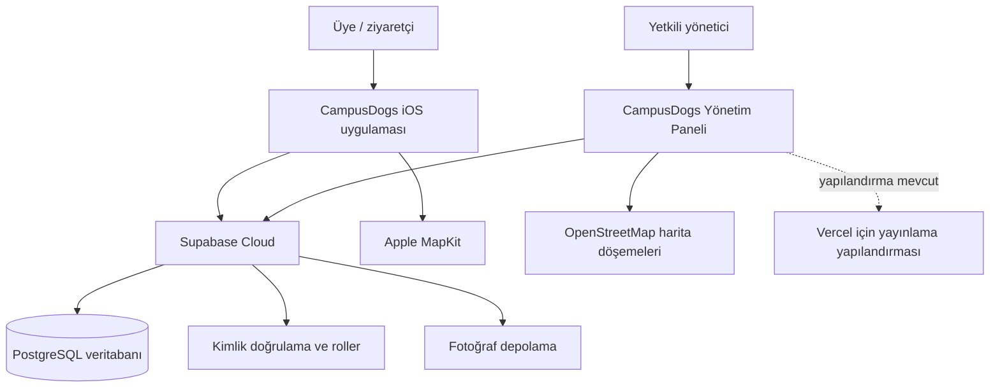

# CampusDogs Teknik Genel Bakış

> Bu belge, proje kaynak kodu ve yerel yapılandırmalar incelenerek hazırlanmıştır. Bir özelliğin kaynak kodunda bulunması, o özelliğin canlı Supabase veya Vercel ortamında ayrıca doğrulandığı anlamına gelmez.

## 1. CampusDogs nedir?

CampusDogs, kampüste yaşayan köpeklerle ilgili bilgileri tek merkezden düzenlemeyi ve bu bilgileri ziyaretçilere anlaşılır biçimde sunmayı amaçlayan bir sistemdir.

Sistemin iki yüzü vardır:

- **iPhone uygulaması:** Kullanıcıların aktif köpekleri, kamuya açık sağlık ve bakım bilgilerini, yayınlanmış duyuruları ve son kaydedilen konumları görmesini sağlar. Kullanıcılar kimlik vermeden gözlem bildirimi de gönderebilir.
- **Yönetim Paneli:** Yetkili yöneticilerin köpek, sağlık kaydı, bakım ikonu, tasma kaydı, duyuru ve gözlem bildirimi süreçlerini yönetmesini sağlar.

Bu yapı, dağınık bilgi yerine aynı veriye dayanan ortak bir çalışma alanı oluşturur. Örneğin yönetici bir köpeğin sağlık durumunu güncellediğinde değişiklik merkezi veritabanına kaydedilir; iPhone uygulaması daha sonraki veri okumasında aynı güncel bilgiyi alır.

Başlıca faydalananlar kampüs hayvan refahı sorumluları, gönüllüler, öğrenciler, ziyaretçiler ve bakım süreçlerini takip eden yöneticilerdir.

## 2. Genel mimari

CampusDogs'ta iOS uygulaması ve yönetim paneli aynı merkezi arka uca bağlanır. Arka uçta Supabase; veritabanı, kimlik doğrulama, dosya depolama ve erişim kurallarını bir araya getirir.

**Notlar:**

- iOS uygulaması üyeler için giriş ekranı içermez; yalnızca üyeye açık verileri okur ve anonim gözlem bildirimi gönderir.
- Yönetim paneline girmek için Supabase oturumu ve ayrıca yönetici yetkisi gerekir.
- `apps/admin/vercel.json` dosyası tek sayfa uygulaması yönlendirmesi için Vercel yapılandırması içerir. Bu, güncel yerel sürümün Vercel'e yayımlandığını kanıtlamaz.

## 3. Kullanılan teknolojiler

| Alan | Teknoloji | Günlük dille amacı |
| --- | --- | --- |
| iPhone uygulaması | Swift | iOS uygulamasının programlama dili. |
| iPhone arayüzü | SwiftUI | Ekranların, butonların, listelerin ve formların oluşturulması. |
| iOS geliştirme | Xcode | Uygulamayı derleme, simülatörde ve iPhone'da çalıştırma aracı. |
| iOS minimum sürümü | iOS 17 | Uygulamanın hedeflediği en düşük iOS sürümü. |
| iOS veri bağlantısı | supabase-swift | Uygulamanın Supabase ile güvenli veri alışverişi yapmasını sağlayan kütüphane. |
| Harita (iOS) | Apple MapKit | iPhone içinde köpek konumlarını haritada gösterir. |
| Yönetim paneli | React 19 | Tarayıcıda çalışan yönetim ekranlarının arayüz çatısı. |
| Panel dili | TypeScript / JavaScript | Yönetim panelinin ekran ve işlem mantığı. |
| Web geliştirme/derleme | Vite | Paneli yerelde çalıştırır ve üretim için derler. |
| Panel yönlendirmesi | React Router | Panel içindeki sayfalar arası geçişi sağlar. |
| Panel tasarımı | CSS | Sayfa düzeni, renkler ve mobil uyum. |
| Arka uç | Supabase | Veritabanı, kimlik doğrulama, depolama ve erişim kurallarının hizmeti. |
| Veritabanı | PostgreSQL | Köpek, sağlık, duyuru, konum ve ilişki kayıtlarının tutulduğu sistem. |
| Veritabanı tanımı | SQL | Tablo, kural ve erişim politikalarının tanımlandığı dil. |
| Harita (web) | OpenStreetMap | Yönetim panelindeki harita zemin döşemelerini sağlar. |
| Web barındırma hedefi | Vercel | Yönetim paneli için yapılandırması bulunan yayınlama hizmeti. Canlı durum doğrulanmamıştır. |

## 4. Sistem nasıl çalışır?

### 4.1 Ortak veri kaynağı

Yönetici panelinden eklenen veya değiştirilen kayıtlar PostgreSQL veritabanına gider. iOS uygulaması, yalnızca erişmesine izin verilen kayıtları aynı veritabanından alır. Böylece iki uygulama ayrı görünse de aynı köpek bilgilerine dayanır.

Örnek: Yönetici bir köpeğin durumunu **Gözlem altında** olarak değiştirir. Bu değer `dogs` tablosunda saklanır. iPhone uygulaması köpek listesini veya profilini yeniden yüklediğinde yeni durumu gösterir.

### 4.2 Başlıca veriler ve ilişkiler

| Veri | Ne tutar? | Kim kullanır? |
| --- | --- | --- |
| `dogs` | Köpeğin adı, fotoğraf yolu, cinsiyeti, tahmini doğum tarihi, kamuya açık sağlık/bakım bilgisi ve aktiflik durumu | iOS ve yönetim paneli |
| `health_records` | Zaman damgalı sağlık/treatment geçmişi; üyelere açık olup olmadığı | Yönetici; yalnızca **Üyelere açık** seçilenler iOS'ta görünür |
| `care_icons` | Bakım ikonunun adı, anahtarı ve açıklaması | iOS ve yönetim paneli |
| `dog_care_icons` | Bir köpeğe hangi bakım ikonlarının atandığı | iOS ve yönetim paneli |
| `dog_locations` | Her köpek için en son kaydedilen enlem, boylam ve güncellenme zamanı | iOS ve yönetim paneli |
| `member_reports` | Anonim gözlem bildiriminin köpeği, kategorisi, açıklaması, önem derecesi ve inceleme durumu | iOS gönderir; yönetici inceler |
| `announcements` | Başlık, metin, yayın durumu ve yayın zamanı | Yönetici yönetir; yayımlananlar iOS'ta görünür |
| `collars` ve `dog_collar_assignments` | Tasma kaydı ve etkin köpek–tasma eşlemesi | Yönetim paneli |
| `admin_users` | Yönetici yetkisine sahip Supabase kullanıcılarının kaydı | Erişim denetimi |
| `admin_notes` | Yalnızca yöneticilere ait özel notlar | Veritabanında desteklenir; mevcut panel rotalarında ayrı bir not ekranı yoktur |

### 4.3 Sağlık, duyuru ve bildirim akışları

- Yönetici sağlık kaydı eklerken bilgiyi **Üyelere açık** yapabilir. Bu durumda iOS profilindeki **Sağlık Geçmişi** bölümünde görünür; özel kayıtlar görünmez.
- iPhone kullanıcısı **Gözlem Bildir** formunda köpek, sorun türü, açıklama ve önem derecesini seçer. Bildirim kimlik bilgisi olmadan `member_reports` kaydı olarak iletilir.
- Yönetici, **Gözlem Bildirimleri** ekranında bildirimi inceler, durumunu günceller ve gerekiyorsa çözüm notu ekler. Bu yönetim durumu iOS üyesine gösterilmez.
- Yönetici duyuruyu taslak olarak kaydedebilir veya yayımlayabilir. iOS yalnızca yayımlanmış duyuruları listeler.

## 5. Ana işlevler

### iOS uygulaması

| Bölüm | Kullanıcının yapabildiği |
| --- | --- |
| Ana ekran | **Köpekler**, **Harita**, **Bluetooth** ve **Duyurular** bölümlerine geçer. |
| Köpekler | Aktif köpekleri listeler; profil, yaş, cinsiyet, sağlık durumu, bakım bilgileri ve ikonları inceler. |
| Köpek profili | **Bilgiler**, **Sağlık Geçmişi** ve **Konum** sekmelerini görüntüler; bu profilden gözlem bildirimi açabilir. |
| Harita | Konumu bulunan aktif köpekleri ve son güncelleme zamanlarını gösterir. |
| Gözlem Bildir | Anonim, metin tabanlı gözlem bildirimi gönderir. Fotoğraf ekleme bu sürümde yoktur. |
| Duyurular | Yayımlanmış duyuruları okur. |
| Bluetooth | Geliştirme amaçlı **simüle edilmiş** tarama ile algılanan örnek köpekleri listeler; gerçek tasma taraması değildir. |

### Yönetim paneli

| Bölüm | Yöneticinin yapabildiği |
| --- | --- |
| Dashboard | Aktif köpek, sağlık durumu ve yeni bildirim sayılarını görür; kartlardan ilgili listeye geçer. |
| Köpekler | Köpek ekler, profilini açar, bilgilerini/fotoğrafını günceller, aktiflik ve sağlık durumunu düzenler; ada, sağlığa ve aktifliğe göre sıralar. |
| Sağlık & Tedavi Kayıtları | Güncel sağlık durumunu değiştirir; geçmiş kayıt ekler, düzenler, siler ve üyelere açık seçeneğini belirler. |
| Bakım İkonları | İkon kütüphanesini görüntüler/ekler/düzenler; seçilen köpeğe ikon atar veya atamayı kaldırır. |
| Tasmalar | Donanım kaydını ekler/düzenler, köpeğe etkin tasma atar veya atamayı kaldırır. |
| Gözlem Bildirimleri | Anonim bildirimleri inceler, sıralar, durumunu ve çözüm notunu günceller. |
| Duyurular | Yeni duyuru oluşturur, yayımlar/yayından kaldırır ve kalıcı siler. |
| Köpek Haritası | Son kaydedilen konumları listeden seçerek görüntüler; kaydırma, yakınlaştırma ve uzaklaştırma yapılabilir. |

## 6. Bakım ikonları

Bakım ikonları, köpeğe yaklaşırken veya bakım verirken dikkat edilmesi gereken noktaları kısa ve görsel biçimde anlatır. Yönetici **Bakım İkonları → Köpek Bakım İkonları** bölümünde köpeği seçer, ikon kutularını işaretler ve **Değişiklikleri kaydet** düğmesine basar. iOS profilinde aynı atamalar görünür; kullanıcı ikona dokunarak açıklamayı okuyabilir.

| İkon | Anlamı ve pratik kullanım |
| --- | --- |
| İyileşme Süreci | Tedavi veya toparlanma dönemi sürüyor olabilir; sakin ve özenli davranılmalıdır. |
| Koşmayı Sınırla | Eklem, kalp veya solunum hassasiyeti nedeniyle köpeği koşmaya teşvik etmemek gerekir. |
| Özel Beslenme | Veterinerce belirlenmiş beslenme düzeni olabilir; izinsiz yiyecek verilmemelidir. |
| Görme Hassasiyeti | Çevreyi algılamakta zorlanabilir; yavaş ve sakin yaklaşılmalıdır. |
| İşitme Hassasiyeti | Sesleri daha az algılıyor olabilir; ani hareket ve seslerden kaçınılmalıdır. |
| Düzenli Kontrol | Periyodik veteriner kontrolü gerektirebilir. |
| Diğer | Mevcut özel veya bilinmeyen ikon anahtarları için kullanılan özgün görsel kategoridir. Standart veri tohumunda zorunlu yedinci bir kategori olarak tanımlı değildir; varsa açıklaması kaydın kendi adından okunmalıdır. |

İkon anahtarları veritabanı ve iOS uyumluluğu için teknik olarak saklanır; kullanıcı arayüzünde anlamlı Türkçe ad ve açıklama gösterilir.

## 7. Konum ve harita sistemi

### Üç farklı kavram

| Kavram | Anlamı |
| --- | --- |
| Telefonun mevcut konumu | Konum izni verildiğinde iPhone'un Core Location ile o anda aldığı konumdur. |
| Son yayınlanan konum | `dog_locations` kaydına en son yazılmış nokta ve zaman damgasıdır. Haritalarda gösterilen budur. |
| Gerçek zamanlı takip | Tasmadan sürekli veri gelmesi ve haritanın anlık güncellenmesidir. **Mevcut projede uygulanmamıştır.** |

Bluetooth ekranındaki demo akışı, aktif köpeklerden simüle edilmiş bir tarama sonucu oluşturur. Kullanıcı bir köpeği seçip konumu güncellediğinde uygulama telefonun mevcut konumunu bir kez almayı dener ve `submit_dog_location` adlı arka uç işlemiyle ilgili köpeğin **son konum** kaydını günceller. Bu, telefonun köpeğin yanında olduğu varsayımına dayalı, tek seferlik bir işlem olarak tasarlanmıştır.

Haritalar yalnızca mevcut kayıtları gösterir. Aynı koordinata sahip birden fazla köpek olduğunda, görünür işaretlerin üst üste binmemesi için arayüzde küçük görsel ofsetler uygulanır; veritabanındaki gerçek koordinatlar değiştirilmez.

## 8. Veri güvenliği ve mahremiyet

### Roller

- **Anonim üye/ziyaretçi:** Aktif köpekleri, kamuya açık bakım ikonlarını, yayımlanmış duyuruları, aktif köpeklerin son konumlarını ve yalnızca üyelere açık seçilmiş sağlık kayıtlarını okuyabilir. Aktif köpek için anonim gözlem bildirimi gönderebilir.
- **Normal yönetici:** Supabase ile giriş yaptıktan ve `is_admin()` denetiminden geçtikten sonra yönetim verilerini yönetebilir.
- **Süper yönetici:** Şemada `is_super_admin()` desteği ve yönetici oluşturma Edge Function kaynak kodu vardır. Ancak mevcut panel rotalarında bir yönetici yönetim ekranı yoktur; Edge Function'ın canlıya dağıtıldığı bu incelemede doğrulanmamıştır.

### Koruma katmanları

- **Kimlik doğrulama:** Yönetici, e-posta ve parola ile Supabase oturumu açar.
- **Yetkilendirme:** Oturum açmış olmak tek başına yeterli değildir; yönetici kaydı gerekir.
- **RLS (Satır Düzeyi Güvenlik):** Veritabanı, her istekte hangi satırın okunabileceğini veya değiştirilebileceğini denetler. Arayüzdeki gizleme, tek güvenlik katmanı değildir.
- **Depolama politikaları:** Köpek fotoğrafları için yalnızca yöneticiye tanımlı, klasör ve dosya uzantısı kontrolleri olan yazma kuralları vardır. Köpek fotoğraf kovası herkese açık okumaya ayarlanmıştır.
- **İstemci anahtarları:** iOS ve web uygulamalarında yalnızca yayınlanabilir istemci anahtarı kullanılmalıdır. Sunucu yöneticisi anahtarı hiçbir zaman uygulama, tarayıcı veya belge içine konulmamalıdır.

Sistemde köpek profili, sağlık/bakım bilgisi, bildirim metni, duyuru, tasma tanımlayıcısı ve son kaydedilen konum bulunabilir. Konum bilgisi hassas kabul edilmeli; gerçek ortamda yalnızca gerekli kişilerle ve kurum kurallarına uygun biçimde paylaşılmalıdır.

### Önemli mevcut sınır

`submit_dog_location` işlemi anonim çağrılabilir ve koordinatın geçerli aralıkta, köpeğin de etkin olduğunu denetler. Ancak mevcut kod, koordinatın gerçekten bir tasma veya belirli bir fiziksel köpekten geldiğini doğrulamaz. Bu nedenle demo dışında konum verisine mutlak doğruluk atfedilmemeli; gerçek donanım aşamasında imzalı/doğrulanabilir cihaz protokolü, hız sınırlama ve konum mantıklılık denetimleri eklenmelidir.

## 9. Uygulananlar, demo olanlar ve sınırlamalar

| Durum | Özellik | Açıklama |
| --- | --- | --- |
| Uygulanmış (kaynakta) | Köpek profilleri, yaş gösterimi, sağlık durumları, bakım ikonları, duyurular, anonim metin bildirimi, yönetim iş akışları | Canlı ortam doğrulaması ayrı bir test gerektirir. |
| Uygulanmış (kaynakta) | Son konumun kaydedilmesi ve iOS/web haritada gösterilmesi | Sürekli takip değildir. İnternet ve izin gerekir. |
| Simülasyon | Bluetooth taraması | `MockBluetoothScanner` ilk iki aktif köpeği yaklaşık 700 ms sonra simüle edilmiş şekilde algılanmış gösterir. Fiziksel BLE taraması yapılmaz. |
| Ertelenmiş | Gerçek tasma/Bluetooth iletişimi | `CoreBluetoothScanner` yer tutucudur; cihaz protokolü belirlenmeden çalışmaz. |
| Arayüzde yok | Üye gözlemine fotoğraf ekleme | Veritabanı/depolama altyapısında alanlar bulunsa da iOS MVP formu metin tabanlıdır. |
| Arayüzde yok | Mevcut duyuru metnini düzenleme | Panel yeni duyuru oluşturur; mevcut duyuruyu yayımlar/yayından kaldırır veya siler. Metin düzenleme ekranı yoktur. |
| Doğrulama gerektirir | Vercel canlı sürümü ve Edge Function dağıtımı | Yerel yapılandırma/kaynak dosyası vardır; canlı durum bu belgede doğrulanmamıştır. |

## 10. Kısa sözlük

| Terim | Basit açıklama |
| --- | --- |
| Ön yüz (frontend) | Kullanıcının ekranda gördüğü ve kullandığı bölüm. |
| Arka uç (backend) | Veriyi saklayan, kuralları uygulayan ve uygulamalara hizmet veren bölüm. |
| Veritabanı | Bilgilerin düzenli olarak saklandığı yapı. |
| PostgreSQL | CampusDogs verilerini saklayan veritabanı teknolojisi. |
| Supabase | Veritabanı, giriş, depolama ve erişim kurallarını sağlayan bulut hizmeti. |
| API | Uygulamaların birbiriyle veri alışverişi yapma yolu. |
| Kimlik doğrulama | Kullanıcının kim olduğunu kontrol etme işlemi. |
| Yetkilendirme | Kimliği doğrulanan kişinin hangi işlemleri yapabileceğini belirleme. |
| RLS | Her veri satırı için erişim kuralı koyan veritabanı güvenliği. |
| iOS | iPhone işletim sistemi. |
| Swift | iOS uygulamasının dili. |
| SwiftUI | Swift ile ekran tasarlama aracı. |
| React | Web yönetim paneli arayüz çatısı. |
| TypeScript | Web kodunda hata riskini azaltan JavaScript tabanlı dil. |
| GPS / konum | Telefonun bulunduğu yeri belirlemeye yardımcı konum hizmeti. |
| Bluetooth | Yakındaki kısa menzilli cihazlarla iletişim teknolojisi. Bu projede gerçek tarama henüz yoktur. |
| MapKit | Apple'ın iOS harita çerçevesi. |
| RPC | Uygulamanın veritabanında tanımlı bir işlemi çağırma yöntemi. |
| Bulut barındırma | Uygulamanın veya hizmetin internet üzerindeki sunucularda çalışması. |

## 11. Sunumda güvenli ve doğru ifade örnekleri

- “iOS uygulaması ve yönetim paneli aynı Supabase veritabanındaki yetkili verilere bağlanıyor.”
- “Harita, köpeğin son yayınlanan konumunu gösteriyor; bu sürümde sürekli gerçek zamanlı tasma takibi yok.”
- “Bluetooth ekranı donanım entegrasyonu öncesindeki kullanıcı akışını göstermek için simüle edilmiş tarama kullanıyor.”
- “Yönetici işlemleri hem giriş kontrolü hem de veritabanı erişim kurallarıyla korunuyor.”
- “Vercel için yayınlama yapılandırması var; bu belgeden güncel yerel değişikliklerin canlıya alındığı sonucu çıkarılamaz.”
