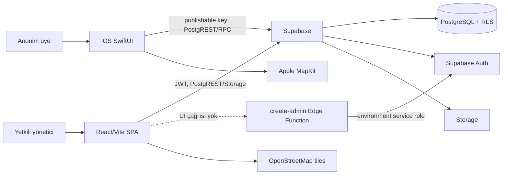
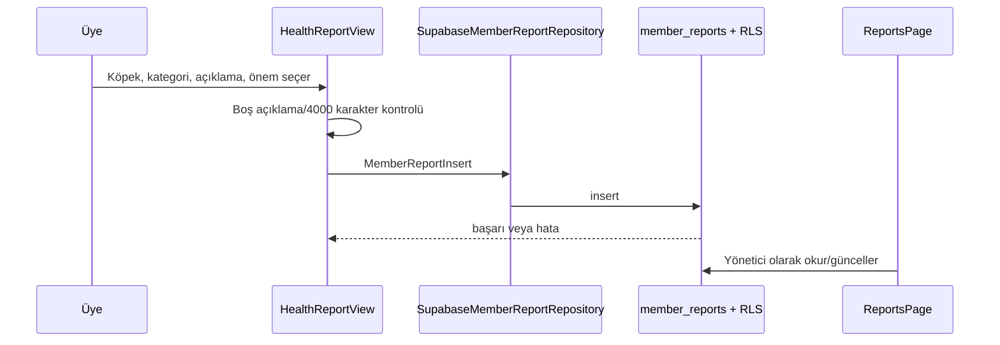
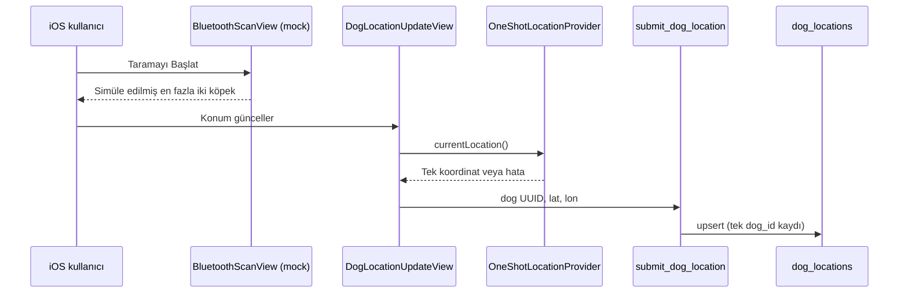

# Campus Dogs — Merkezi Teknik Proje Bağlamı

> **Denetim tarihi:** 7 Kasım 2026
> **Kapsam:** Yerel kaynak kod, build/manifest dosyaları, Supabase migration ve Edge Function kaynakları, mevcut dokümantasyon ve güvenli yerel derlemeler.
> Bu denetim Cloud verisi, migration, Storage, Edge Function veya Vercel dağıtımı değiştirmedi. Gizli değerler belgelenmez.

Bu belge, sonraki geliştirici ve AI coding agent için teknik devir kaynağıdır. Durumlar: **DONE** doğrudan doğrulandı; **IMPLEMENTED** kaynakta var ama ilgili Cloud/E2E davranışı doğrulanmadı; **IN PROGRESS** geçici/kısmi; **PLANNED/DEFERRED** uygulanmamış niyet; **BLOCKED** dış yetki/karar bekliyor; **UNKNOWN** kanıt yok.

## 1. Proje özeti, vizyon ve problem

Campus Dogs, kampüsteki köpekler hakkında ortak ve kontrollü bilgi paylaşımı için iki istemcili bir Supabase uygulamasıdır:

- `apps/ios`: Hesapsız SwiftUI iPhone uygulaması; aktif köpek profillerini, kamuya açık bakım/sağlık bilgisini, duyuruları ve son kaydedilen konumu gösterir; anonim gözlem bildirimi iletir.
- `apps/admin`: Supabase ile giriş yapan yöneticilerin köpek, fotoğraf, sağlık kaydı, bakım ikonu, tasma kaydı, duyuru ve gözlem bildirimlerini yönettiği React SPA.
- `supabase`: PostgreSQL şeması, RLS, Storage policy'leri, geliştirme seed'i ve Deno Edge Function kaynakları.

Ürün; sağlık/bakım uyarısı, duyuru ve gözlem bilgisinin dağınık kalmasını azaltmayı; üyelerin gözlemlerini yönetim ekibine ulaştırmayı; kamuya açık bilgi ile özel yönetim verisini ayırmayı amaçlar. Gerçek BLE tasma iletişimi ve sürekli gerçek zamanlı takip mevcut ürün değildir.

## 2. Hedef kullanıcılar ve kullanım senaryoları

| Kullanıcı | Amaç | Yetki sınırı |
| --- | --- | --- |
| Anonim üye/ziyaretçi | Köpeği tanımak, bakım uyarısı/duyuru görmek, gözlem bildirmek | Hesap yok; yalnızca RLS ile açık verileri okur; admin notu, özel sağlık kaydı ve rapor geçmişi yoktur. |
| Normal yönetici | Operasyonel veriyi yönetmek | Supabase Auth oturumu, `is_admin()` ve RLS gerekir. |
| Süper yönetici | Gelecekte/Function üzerinden normal admin oluşturmak | `is_super_admin()` gerekir; güncel panelde bu iş için UI/route yoktur. |
| Bluetooth geliştiricisi | Gerçek tasma protokolünü eklemek | Mevcut mock scan veya telefon GPS'i tasma doğrulaması değildir. |

## 3. Özellik durumu

| Özellik | İş amacı | Durum | Kaynak kanıtı / sınır |
| --- | --- | --- | --- |
| Aktif köpek listesi ve profil | Üyeyi bilgilendirmek | IMPLEMENTED | `DogsView`, `DogDetailView`, `SupabaseDogRepository.activeDogs()`. |
| Dinamik yaş | Doğum tarihini yıl/ay olarak sunmak | IMPLEMENTED | `ProfileAgeMetadataView`; takvim tabanlı hesap, her 24 saatte yenileme. |
| Public sağlık geçmişi | Üyelere seçili sağlık kaydını göstermek | IMPLEMENTED | `HealthHistorySection` ve `publicHealthRecords(for:)`; E2E UI testi yok. |
| Bakım ikonları | Yaklaşım/bakım uyarısı | IMPLEMENTED | Altı standart anahtar + `other` SVG/PDF asset fallback. |
| Anonim gözlem bildirimi | Üye gözlemini yöneticiye taşımak | IMPLEMENTED | `HealthReportView` → `member_reports`; canlı insert test edilmedi. |
| Duyurular | Yönetici mesajlarını yayınlamak | IMPLEMENTED | iOS yalnız `is_published=true` okur. |
| Son konum haritası | Son kaydedilen noktayı göstermek | IMPLEMENTED | iOS MapKit, web OSM; sürekli takip değildir. |
| Telefon konumunu tek seferde yayınlama | Demo akışında son konumu güncellemek | IMPLEMENTED, güvenlik kararı gerekli | `OneShotLocationProvider` → RPC; canlı write test edilmedi. |
| Bluetooth taraması | Yakındaki tasma/köpek bulmak | IN PROGRESS / simülasyon | `MockBluetoothScanner` çalışır, `CoreBluetoothScanner` boştur. |
| Köpek/fotoğraf CRUD | Yönetim operasyonu | IMPLEMENTED | Güvenli upload/değiştirme sırası var; admin Cloud write test edilmedi. |
| Sağlık, tasma, ikon, rapor yönetimi | Operasyon yönetimi | IMPLEMENTED | İlgili admin sayfaları var; role matrix test edilmedi. |
| Admin oluşturma | Süper admin yönetimi | IN PROGRESS | `create-admin` source var; React UI çağırmıyor, deploy UNKNOWN. |

## 4. İşlevsel ve işlevsel olmayan gereksinimler

### İşlevsel gereksinimler

- Aktif köpekler üyeye görünmeli; pasif köpekler genel listeden gizlenmelidir.
- Köpek profilinde kamuya açık sağlık durumu, bakım metni, yaş ve atanmış ikonlar görünmelidir.
- Yönetici köpek ekleyebilmeli/düzenleyebilmeli, fotoğraf yönetebilmeli ve köpeği pasife alabilmelidir.
- Yönetici sağlık geçmişi ekleyebilmeli/düzenleyebilmeli/silebilmeli ve `is_public` seçebilmelidir.
- Üye, aktif köpek için kimlik toplamadan metin bildirim gönderebilmelidir.
- Yönetici raporu `new`, `reviewing`, `resolved`, `dismissed` olarak güncelleyebilmeli ve çözüm notu ekleyebilmelidir.
- Yönetici duyuru oluşturabilmeli, yayımlayabilmeli/yayından kaldırabilmeli ve kalıcı silebilmelidir.
- Kayıt varsa son konum ve zaman iOS/web haritalarında gösterilmelidir.

### İşlevsel olmayan gereksinimler

| Gereksinim | Mevcut yaklaşım | Sınır |
| --- | --- | --- |
| Yetkilendirme | Supabase Auth + admin RPC + RLS | Gerçek admin/non-admin Cloud matrisi doğrulanmadı. |
| Gizli anahtar yönetimi | Publishable key istemcide; service role Function environment'ta | Local config değerleri belgelenmez/commitlenmez. |
| Kullanıcı hataları | Loading/error/empty state, Türkçe genel hata mesajları | Merkezi telemetry yok. |
| Veri bütünlüğü | UUID, FK, enum, check, unique index, trigger | Cloud migration uygulanma durumu UNKNOWN. |
| Ölçek/performance | Küçük veri için ekran bazlı fetch | Paging, shared cache, offline queue, performance izleme yok. |

## 5. Depo yapısı ve Git durumu

```text
campus-dogs/
├── apps/
│   ├── admin/                  React + TypeScript + Vite SPA
│   │   ├── src/app/            Route ağacı ve route guard
│   │   ├── src/pages/          Yönetim sayfaları
│   │   ├── src/services/       Supabase client/repository
│   │   └── src/assets/         Care icon SVG'leri
│   └── ios/                    SwiftUI iPhone uygulaması
│       ├── CampusDogs/         App, Core, Features, Models, Services, UI, Assets
│       ├── CampusDogs.xcodeproj/
│       └── Config/             xcconfig kaynakları
├── supabase/
│   ├── migrations/             001–006 SQL sürümleri
│   ├── functions/              Deno Edge Function kaynakları
│   └── seed.sql                Tekrarlanabilir dev fixture'ı
├── docs/                       Ürün, güvenlik, test ve kullanım belgeleri
└── README.md
```

`dist`, `node_modules`, Xcode kullanıcı verileri ve `.temp` üretilmiş/yerel artifakttır. `.gitignore`, `.env.local` ve `apps/ios/Config/Supabase.xcconfig` değerlerini izlem dışı tutar.

Çalışma alanında veya iki üst dizinde `.git` dizini bulunmadı. Bu nedenle branch, commit geçmişi, kullanıcı değişiklikleri ve working-tree durumu **UNKNOWN** durumundadır.

## 6. Teknoloji yığını ve bağımlılıklar

| Katman | Doğrulanabilir teknoloji/sürüm | Kullanım |
| --- | --- | --- |
| Web UI | React manifest `^19.1.1`; lockfile `19.3.1` | `apps/admin/src` SPA. |
| Web routing | `react-router-dom` manifest `^7.8.2`; lockfile `7.18.5` | `App.tsx`, `AdminLayout`. |
| Web dil/build | TypeScript manifest `^5.9.2`/lockfile `5.9.3`; Vite manifest `^7.1.3`/buildte `7.3.7` | Strict TS build ve bundle. |
| Web backend SDK | `@supabase/supabase-js` manifest `^2.57.4`; lockfile `2.118.0` | Auth, PostgREST, Storage. |
| iOS | Swift 5, SwiftUI, iOS 17.0 target | Native member app. |
| iOS backend SDK | `supabase-swift` `2.55.6` | `Package.resolved`; PostgREST/RPC/Storage URL. |
| Apple framework | MapKit, CoreLocation, CoreBluetooth | Map, one-shot location, mock/protocol boundary. |
| Backend | Supabase / PostgreSQL | Database, Auth, Storage, Edge Function. |
| Function runtime | Deno + ESM Supabase JS `@2` | `create-admin`, `invite-admin`. |
| Harita | MapKit; OpenStreetMap tiles | iOS map; web `DogMapPage`. |
| Web deploy adayı | Vercel | Sadece SPA rewrite tanımlı, live deployment UNKNOWN. |

Admin tarafında form/UI/state management için ek framework yok; React local state, CSS ve `useAsyncData` kullanılır. iOS lockfile; `swift-crypto`, `swift-clocks`, `swift-http-types`, `swift-asn1`, `swift-concurrency-extras`, `swift-issue-reporting` ve `xctest-dynamic-overlay` gibi transitif paketleri gösterir. Bağımlılık güvenlik güncelliği bu denetimde dış kaynakla doğrulanmadı.

## 7. Sistem mimarisi



Özel REST controller/API sunucusu yoktur; istemciler Supabase yüzeylerini doğrudan kullanır. Frontend guard yalnızca UX kontrolüdür; gerçek yetki sınırı RLS ve Storage policy'leridir.

## 8. Mimari desenler ve tasarım kararları

| Karar | Uygulama | Etki |
| --- | --- | --- |
| Tek shared backend | iOS ve web aynı Supabase projesine bağlanır | Kamu ve yönetim deneyimi ayrılır, veri merkezi kalır. |
| RLS-first | SQL policy + `is_admin()`/`is_super_admin()` | UI gizleme yetki yerine geçmez. |
| iOS DTO/repository | `DatabaseModels.swift`, `SupabaseRepositories.swift` | SwiftUI ekranları sorgu ayrıntısından ayrılır. |
| Web repository | `adminRepository.ts` | DB/Storage çağrıları sayfalardan merkezileşir; dosya büyüktür. |
| Ekran-local state | SwiftUI `@State`; React `useState` + `useAsyncData` | Küçük uygulama için basit; shared cache yok. |
| Son konum modeli | `dog_locations.dog_id` PK + RPC upsert | Tarihçe değil, köpek başına tek son nokta. |
| Güvenli fotoğraf replacement | DB satırı → upload → DB `photo_path` → eski object cleanup | Eski fotoğrafın erken silinmesini önler. |
| Mock sınırı | `BluetoothScanner` protocol + mock + boş core scanner | Gerçek hardware eklenene kadar izolasyon sağlar. |

## 9. Ana modüller ve giriş noktaları

### Admin

| Dosya | Sorumluluk |
| --- | --- |
| `src/main.tsx` | React ve `BrowserRouter` giriş noktası. |
| `src/app/App.tsx` | `/login` ve korunan Dashboard/Köpekler/Sağlık/Bakım İkonları/Tasmalar/Raporlar/Duyurular/Harita route'ları. |
| `src/app/ProtectedRoute.tsx` | Session + `rpc('is_admin')` UX kontrolü. |
| `src/layouts/AdminLayout.tsx` | Desktop sidebar, mobile drawer, logout. |
| `src/services/supabase.ts` | `VITE_SUPABASE_URL`, `VITE_SUPABASE_PUBLISHABLE_KEY` ile typed client. |
| `src/services/adminRepository.ts` | Dog/photo, health, care icon, collar, report, announcement, location erişimi. |
| `src/hooks/useAsyncData.ts` | `data/error/loading/refresh` state hook'u. |
| `src/types/database.ts` | Elle korunmuş DB/RPC TypeScript sözleşmesi. |

### iOS

| Dosya | Sorumluluk |
| --- | --- |
| `App/CampusDogsApp.swift` | `@main`, NavigationStack, app-home reset, config yoksa güvenli ekran. |
| `Core/Network/SupabaseConfiguration.swift` | Info.plist üzerinden publishable config okur; eksikse client `nil`. |
| `Models/DatabaseModels.swift` | Codable DTO/snake_case mapping. |
| `Models/Dog.swift` | View model, status, mock örnekler. |
| `Services/SupabaseRepositories.swift` | Dogs, public health, announcement, report, location RPC repository'leri. |
| `Features/Dogs/DogsViews.swift` | Liste, profil, yaş, ikon, public health, profile location. |
| `Features/HealthReports/HealthReportView.swift` | Anonim metin raporu. |
| `Features/Bluetooth/DemoBluetoothView.swift` | Mock scan + one-shot location update. |
| `Core/Location/OneShotLocationProvider.swift` | CoreLocation izin/tek koordinat/tanı logları. |
| `Features/Map/CampusMapView.swift` | MapKit son konum haritası. |
| `UI/CampusDesign.swift` | Palette, ortak UI, care icon asset mapping. |

### Supabase

| Kaynak | Sorumluluk |
| --- | --- |
| `001_initial_schema.sql` | Temel şema, enum, FK/index, trigger, RLS, `is_admin`, `submit_dog_location`. |
| `002_security_hardening.sql` | Function hardening, immutable note author, active collar constraints. |
| `003` / `004` | Private report/announcement image şeması ve hardened anonymous upload policy. |
| `005` / `006` | Süper admin alanı ve public dog-image Storage policy'leri. |
| `functions/create-admin/index.ts` | Local origin allowlist, master check, server-side admin create. |
| `functions/invite-admin/index.ts` | Eski/alternatif invite source; SPA tarafından çağrılmaz. |

## 10. Kritik veri ve yürütme akışları

### Üye köpek profili

1. `DogsView` `SupabaseDogRepository.activeDogs()` çağırır.
2. Repository aktif `dogs`, `dog_care_icons`, `care_icons`, `dog_locations` verilerini ayrı isteklerle okur.
3. İlişkileri dog/icon UUID'leri üzerinden bellekte birleştirir; object path varsa `dog-images` public URL üretir.
4. `DogDetailView` bilgi, bakım uyarısı, ikon, public sağlık ve konum sekmelerini gösterir.
5. `ProfileAgeMetadataView`, `"Doğum tarihi: YYYY-MM-DD"` değerini takvim hesabıyla yıl/ay biçimine dönüştürür.

**Sınır:** Dört ardışık isteğin biri hata verirse köpek yüklemesi de hata verir; aynı veri birden çok ekranda tekrar okunur.

### Anonim gözlem bildirimi



Kategoriler: `Topallama`, `Yaralanma`, `Halsizlik`, `Davranış Değişikliği`, `Diğer`. Severity değerleri `low`, `medium`, `high`; fotoğraf için `image_path:nil` gönderilir. Rapor geçmişi, dedup/cooldown veya üyeye admin durumunu gösterme yoktur.

### Son konum/GPS demo akışı



`MockBluetoothScanner` yaklaşık 700 ms sonra ilk iki aktif köpeği üretir; fiziksel BLE paketi değildir. `OneShotLocationProvider` servis/izin kontrolü, `requestWhenInUseAuthorization()` ve `requestLocation()` kullanır; callback ve `CLError` tanılarını `print` eder. Haritalar yalnız son yazılmış noktayı gösterir. Sürekli takip, background location ve collar telemetry yoktur.

### Köpek/fotoğraf yönetimi

`DogsPage.DogForm.submit()` boş doğum tarihini JS `null` yapar; boş string/literal `"null"` DATE alanına gitmez. Fotoğraflı kayıt sırası:

1. `saveDog` ile dog row insert/update.
2. `uploadDogPhoto` ile `dogs/{dogId}/{randomUUID}.{ext}` object upload.
3. Yeni path'i `photo_path`e yaz.
4. Başarılı replacement sonrası eski object'i sil.

Referans update başarısızsa yeni object temizlenmeye çalışılır; eski object korunur. Upload başarısızsa yeni dog row kalabilir ve profil üzerinden yeniden deneme yapılabilir. Client JPEG/PNG/WebP ve 5 MB kontrolü yapar; bucket'ın otoriter Dashboard ayarları ve gerçek admin Storage E2E sonucu UNKNOWN.

### Care icon ataması

`CareIconsPage` kütüphane/atama sekmelerini kullanır. Web `CareIconGlyph` ve iOS `careIconAsset(_:)` şu anahtarları asset'e eşler: `recovery`, `limit_running`, `special_diet`, `vision_sensitivity`, `hearing_sensitivity`, `regular_checkup`, `other`. Bilinmeyen anahtar recovery'e değil `other`e düşer.

`setDogIcons()` önce tüm ilişki satırlarını siler, sonra seçilenleri insert eder. Bu transaction/RPC değildir; insert hata verirse eski atamalar boş kalabilir.

### Sağlık, duyuru, rapor ve tasma

| Modül | Gerçek davranış | Sınır |
| --- | --- | --- |
| `HealthPage` | Güncel durum ve geçmiş kayıt; create/edit/delete/public seçimi | Admin E2E yapılmadı. |
| `ReportsPage` | Sıralama + inline durum/çözüm notu update | Report delete ve member-side status yok. |
| `AnnouncementsPage` | Create, publish/unpublish, kalıcı delete | Var olan title/body edit UI ve image UI yok. |
| `CollarsPage` | Kayıt/düzenleme, etkin atama, unassign | Gerçek Bluetooth iletişimi yok. |
| `DogMapPage` | OSM tile, marker, drag/pinch/wheel, +/- ve co-located visual offset | Tek last-known-location modeli. |

## 11. Veritabanı mimarisi

| Tablo | Amaç | Önemli kural |
| --- | --- | --- |
| `admin_users` | Auth user–admin eşlemesi | Auth FK, 005 `is_super_admin`. |
| `dogs` | Köpek ana kaydı | UUID PK, adı check, nullable date, enum health, `is_active`. |
| `health_records` | Tarihli sağlık kaydı | `dog_id` FK, `is_public`. |
| `care_icons` | Paylaşılan ikon metadata | `name` unique, key/açıklama. |
| `dog_care_icons` | Dog–icon M:N | Bileşik PK. |
| `dog_locations` | Son nokta | `dog_id` PK, lat/lon check; tarihçe değildir. |
| `member_reports` | Anonim gözlem | `dog_id` FK, severity/status enum, 1–4000 açıklama. |
| `admin_notes` | Özel admin notu | Admin author FK, yazar değişmez. |
| `announcements` | Taslak/yayın | `is_published`, `published_at`, `image_path`. |
| `collars` | Tasma envanteri | Unique hardware/opsiyonel advertisement ID. |
| `dog_collar_assignments` | Tasma atama geçmişi | Her dog/collar için tek etkin atama. |

Migration'lar ileri yönlüdür; uygulanmış dosyalar değiştirilmemelidir. Yeni davranış yeni migration ve yetkili review gerektirir. `supabase/seed.sql` yalnız development fixture'ıdır; manuel SQL Editor uygulaması gerekir, gerçek konum/tasma/üye kimliği/credential üretmez. `supabase/care_icon_standardization.sql` da migration değildir: mevcut ikon kayıtlarını altı standart anahtara göre güncellemek/eksik iki kaydı eklemek için hazırlanmış, manuel ve yetkili inceleme gerektiren veri scriptidir.

## 12. API ve dış entegrasyonlar

İstemciler özel REST API yerine Supabase PostgREST tabloları, RPC, Storage ve Auth kullanır. Başlıca RPC'ler `is_admin()`, `is_super_admin()` ve `submit_dog_location(target_dog_id, input_latitude, input_longitude)`dir.

| Function | Davranış | Durum |
| --- | --- | --- |
| `create-admin` | `OPTIONS`u auth/body parse öncesi işler; yalnız `localhost:5173` ve `127.0.0.1:5173` origin allowlisti; caller JWT + `is_super_admin`; environment service-role ile user/create admin row; row insert başarısızsa user delete denemesi | IMPLEMENTED, deploy UNKNOWN; current SPA çağırmaz; production origin allowlistte yok. |
| `invite-admin` | `is_admin` sonrası email invite ve `admin_users` insert | Unused/deprecated adayı; current SPA çağırmaz, deploy UNKNOWN. |

Web haritası doğrudan OSM tile endpoint'i kullanır. API key, attribution UI veya tile policy yönetimi yoktur; yüksek trafikli üretim kullanımı öncesi OSM kullanım koşulları incelenmelidir.

## 13. Kimlik doğrulama ve güvenlik mimarisi

| Kaynak | Anonim | Authenticated non-admin | Admin | Temel DB sınırı |
| --- | --- | --- | --- | --- |
| Aktif `dogs` | Okur | Okur | Yönetir | Active veya `is_admin()`. |
| `health_records` | Public okur | Public okur | Yönetir | Public veya admin. |
| İkonlar/aktif dog ilişkileri | Okur | Okur | Yönetir | Public select, admin write. |
| `dog_locations` | Aktif dog için okur | Okur | Yönetir | Active-dog public select. |
| `member_reports` | Aktif dog için insert | Insert | Yönetir | RLS check, admin manage. |
| `announcements` | Published okur | Aynı | Yönetir | Published veya admin. |
| Notes/admin/collar | Yok | Yok | Policy ile | Admin only; note insert author=`auth.uid()`. |

Bu tablo migration kaynaklarından türetilmiştir; hedef Cloud'da policy davranışı ayrı doğrulama gerektirir.

### Güvenlik ve reliability bulguları

| Seviye | Bulgu | Kanıt / etkisi |
| --- | --- | --- |
| High | Anonim konum bütünlüğü | `submit_dog_location` anon/auth execute edilebilir; sadece koordinat aralığı ve active dog kontrolü yapar. Geçerli fakat sahte koordinat public last location'a yazılabilir. |
| High | Admin/Storage write Cloud doğrulaması yok | Kaynak doğru görünse bile migration/policy/function deployment hatası release'te çıkar. |
| Medium | `create-admin` production kullanılabilirliği eksik | Security için explicit allowlist doğru; ancak yalnız local origin kabul eder ve SPA UI çağırmaz. |
| Medium | Anonim report abuse kontrolü yok | Rate limit, CAPTCHA, dedup ve abuse monitoring yok. |
| Medium | Observability sınırlı | Generic hata mesajı; merkezi request ID/log/metric/alert yok. Location yalnız console `print`. |
| Low | İki admin Function modeli | `invite-admin`/`create-admin` farklı model/CORS yaklaşımı; unused function deploy yüzeyi artırır. |
| Informational | Publishable key | İstemcide bulunması tasarıma uygundur; service-role client'a taşınmamıştır. |

## 14. Konfigürasyon, build ve test

| Konum | Değişken | Amaç |
| --- | --- | --- |
| `apps/admin/.env.local` | `VITE_SUPABASE_URL`, `VITE_SUPABASE_PUBLISHABLE_KEY` | Web client. |
| `apps/ios/Config/Supabase.xcconfig` | `SUPABASE_URL`, `SUPABASE_PUBLISHABLE_KEY` | Info.plist build expansion. |
| Edge Function environment | `SUPABASE_URL`, `SUPABASE_ANON_KEY`, `SUPABASE_SERVICE_ROLE_KEY` | Sadece Deno Function. |

```sh
cd apps/admin && npm run dev
cd apps/admin && npm run build
xcodebuild -project apps/ios/CampusDogs.xcodeproj -scheme CampusDogs \
  -configuration Debug -destination 'platform=iOS Simulator,name=iPhone 16,OS=18.6' \
  -derivedDataPath /tmp/CampusDogsAuditDerivedData build
```

### Bu denetimde gerçek sonuçlar

| Kontrol | Sonuç |
| --- | --- |
| Salt-okunur repository/migration/function/docs incelemesi | Passed |
| Git metadata probe | `.git` yok; branch/history/status unavailable. |
| `apps/admin`: `npm run build` | Passed. `tsc -b && vite build` başarılı; minify sonrası `539.22 kB` JS chunk için 500 kB Vite uyarısı. |
| iOS Debug Simulator build | Passed. iPhone 16 / iOS 18.6 hedefiyle `BUILD SUCCEEDED`. |
| Unit/integration/E2E tests | Not executed / mevcut değil. Test target, test script, lint, formatter, CI workflow bulunmadı. |
| Cloud read/write/RLS, role matrix, Storage, RPC write, Function/Vercel deploy | Not executed. |

Build başarısı, canlı Cloud yetkilerinin veya tüm UI kullanıcı yolculuklarının doğrulandığı anlamına gelmez.

## 15. Deployment, logging ve operasyon

- `apps/admin/vercel.json` bütün route'ları `/index.html`e yönlendirir; Vercel domain/deployment/current commit eşleşmesi UNKNOWN.
- `supabase/config.toml` local CLI portlarını ve `project_id = "campus-dogs"` tanımlar; Cloud state'i kanıtlamaz.
- Dockerfile/Compose, CI/CD, merkezi log/trace/metric/alert bulunmadı.
- iOS otomatik signing, iOS 17 target, AppIcon asset seti ve xcconfig config içerir; App Store/TestFlight release pipeline kanıtı yoktur.
- Webde dog-save failure ayrıntısı dev console'a sınırlı yazılır; iOS ekranları generic hata state'i gösterir. `OneShotLocationProvider` hassas bilgiyi üretim telemetry'ye göndermeden console tanısı yapar.

## 16. Geliştirme durumu, çelişkiler ve roadmap

| Alan | Durum | Sonraki bağımlılık |
| --- | --- | --- |
| Admin/iOS derlenebilirliği | DONE | E2E UI/Cloud testleri. |
| Schema/RLS kaynakları | IMPLEMENTED | Migration/policy Cloud doğrulaması. |
| iOS public data UI | IMPLEMENTED | Real device, accessibility, dark mode ve live data test. |
| Admin operasyon UI | IMPLEMENTED | Normal/master role matrix, CRUD/Storage tests. |
| Anonymous report | IMPLEMENTED | Controlled insert → review → cleanup; abuse policy. |
| Phone GPS update | IMPLEMENTED, BLOCKED | Anonim location write kabulü ve source validation/rate limit kararı. |
| Real BLE/collar | PLANNED/DEFERRED | Hardware protocol, trust model, physical device. |
| Production release | BLOCKED | Cloud/Storage/role/deploy/monitoring/CI/device doğrulaması. |

### Belgelerle belirlenen çelişkiler

| Eski belge | Çelişki | Güncel kaynak |
| --- | --- | --- |
| Eski `PROJECT_CONTEXT.md` | `AdminsPage`, `NotesPage`, `/admins` ve admin UI çağrısı anlatır. | `App.tsx`/`AdminLayout` bunları içermez; repository'de note metotları kalmıştır ama UI yoktur. |
| Eski project context/member raporu | Dört SF Symbol icon veya asset catalog yok iddiası. | Güncel SVG/PDF asset'leri altı standart + `other` mapping ile kullanılır. |
| `PRODUCT_SPEC.md` | Tüm adminlerin eşit yetkili olduğu söylenir. | 005 migration süper admin ekler; panelde admin-create UI yoktur. |
| `SECURITY.md` | Report image repository'nin seçilen fotoğrafı yeniden JPEG yaptığı yazılıdır. | Güncel iOS formu fotoğraf seçmez, `image_path:nil` gönderir. |
| `FIRST_ADMIN_SETUP.md` | Invite akışı ana yol gibi görünür. | `create-admin` da kaynakta vardır, ancak SPA ikisini de çağırmaz. |
| `DEVELOPMENT_ROADMAP.md` | Bluetooth navigation re-enable edilmemeli der. | Güncel `HomeView` Bluetooth tile'ı gösterir; yine de mock/demo akışıdır. |

## 17. Teknik borç, güçlü yönler ve öneriler

| Öncelik | Konu | Öneri |
| --- | --- | --- |
| P0 | Anonim location RPC | Gerçek field kullanımından önce ürün kararı, doğrulanabilir source/protocol, rate-limit ve plausibility tasarlayın. |
| P0 | Role/Storage/Function E2E | Kontrollü master/normal/non-admin test matrisi; Cloud policy/migration ve Storage MIME/size kontrolü. |
| P1 | Test/CI yokluğu | Önce repository/RPC/role smoke testleri, ardından CI ekleyin. |
| P1 | Care icon update atomik değil | Transactional RPC veya DB-side atomik güncelleme değerlendirin. |
| P1 | `adminRepository.ts` monolitik | Functional change ile karıştırmadan domain bazlı bölün. |
| P1 | 500 kB admin bundle | Ölçüm sonrası route-level lazy loading/code splitting değerlendirin. |
| P2 | Tekrarlanan fetch | Veri büyürse cache/partial failure handling ekleyin. |
| P2 | Elle yazılmış DB types | Yetkili ortamda type generation süreci planlayın. |
| P2 | Legacy mock kaynaklar | `BluetoothView.swift`, `LocationService.swift`, `Dog.examples`, `mockData.ts` için sahiplik/temizleme kararı verin. |
| P2 | Monitoring yok | Release öncesi error tracking, alert, rate-limit ve retention kararı alın. |

**Güçlü yönler:** RLS tabanlı public/private ayrımı; client/service-role separation; DTO/repository yaklaşımı; fotoğraf replacement sırası; last-known-location ile real-time tracking ayrımı; iOS/webde ortak icon-key sözleşmesi.

## 18. Gelecek geliştirici/AI için zorunlu çalışma ilkeleri

1. Bu belgeyi, ilgili feature kodunu ve ilgili migration'ı birlikte okuyun; geçmiş doküman iddialarını kodla kontrol edin.
2. Admin değişikliğinde route/guard, page, repository, TypeScript types ve RLS etkisini birlikte inceleyin.
3. iOS public veri değişikliğinde DTO, repository, UI loading/error/empty state ve `CampusDesign` mapping'ini birlikte güncelleyin.
4. Yeni public alan için migration/RLS → DTO/types → repository → UI zincirinin tamamını ele alın; private alanı member query'ye eklemeyin.
5. Applied migration değiştirmeyin, Cloud SQL/deploy otomatik çalıştırmayın.
6. Service-role key'i iOS/web client'a asla taşımayın.
7. Dog image path'i object path olarak saklayın ve upload → DB reference → old cleanup sırasını koruyun.
8. Optional DATE alanında `null` kullanın; `"null"` veya boş string göndermeyin.
9. Mock Bluetooth/phone GPS'i gerçek collar telemetry kanıtı saymayın.
10. Konum, token, parola veya config değerini log/dokümana koymayın.

## 19. İnsan onayı gerektiren bilinmeyenler ve başvuru dosyaları

**İnsan onayı gerekenler:** 001–006'nın Cloud uygulanma durumu; `dog-images` public/MIME/size ayarları; Function deploy/secret/SMTP/Auth redirect; master/normal admin role sonuçları; Vercel domain/environment; iOS dağıtım/signing modeli; real BLE hardware protocol; anonymous location write ürün kararı; production monitoring/retention/rate-limit politikası.

**Başvuru dosyaları:**

- Ürün: `README.md`, `docs/PRODUCT_SPEC.md`, `docs/CAMPUSDOGS_TECHNICAL_OVERVIEW_TR.md`, `docs/CAMPUSDOGS_USER_GUIDE_TR.md`.
- Şema/güvenlik: `supabase/migrations/*.sql`, `docs/SECURITY.md`, `docs/DATABASE_SCHEMA.md`, `docs/DOG_IMAGE_STORAGE_SETUP.md`.
- Geçmiş/test: `docs/PHASE_2_4_TEST_REPORT.md`, `docs/MEMBER_APP_STATUS_REPORT.md`, `docs/DEVELOPMENT_ROADMAP.md`.
- Admin: `apps/admin/src/app/App.tsx`, `apps/admin/src/app/ProtectedRoute.tsx`, `apps/admin/src/services/adminRepository.ts`.
- iOS: `apps/ios/CampusDogs/App/CampusDogsApp.swift`, `apps/ios/CampusDogs/Services/SupabaseRepositories.swift`, `apps/ios/CampusDogs/Features/Dogs/DogsViews.swift`.
- Location/Bluetooth: `apps/ios/CampusDogs/Features/Bluetooth/DemoBluetoothView.swift`, `apps/ios/CampusDogs/Core/Location/OneShotLocationProvider.swift`, `apps/ios/CampusDogs/Core/Bluetooth/BluetoothScanner.swift`.
